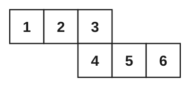

<!-- nav:top -->
[目次](../README.md#目次) · 前へ: [従来型と新型の見分け方](how-to-tell-types.md) · 次へ: [暗号](sections/code-puzzles.md)
<!-- /nav:top -->

# 5分診断

従来型でよく出る4つのタイプから1問ずつ、計4問です。時間を計り、5分以内に解いてみてください。ねらいは点数ではなく、どのタイプから練習を始めるかを決めることです。

問題はすべて、このガイドのために作ったオリジナル問題です。TG-WEBやヒューマネージの資料、ほかの対策サイトから取ったものではありません。

## 問1：暗号

ある規則にしたがうと、「CAT」は「24・26・7」、「BOX」は「25・12・3」と表されます。同じ規則で「SUN」はどう表されますか。

ア. 19・21・14　イ. 7・5・12　ウ. 8・6・12　エ. 8・6・13　オ. 9・7・14

## 問2：推論

A、B、C、D、Eの5人の身長について、次のことが分かっています。同じ身長の人はいません。

- AはBより背が高い
- CはAより背が高いが、Dより背が低い
- BはEより背が高い

背の高いほうから数えて3番目は誰ですか。

ア. A　イ. B　ウ. C　エ. D　オ. E

## 問3：言語（空欄補充）

次の文章の（　）に入る言葉として、最も適切なものはどれですか。

> 計画を立てるときは、うまくいった場合だけでなく、（　）も考えておくとよい。予定どおりに進まなかったときの手を決めておけば、慌てずに済むからだ。

ア. 他人の計画　イ. 過去の成功例　ウ. うまくいかなかった場合　エ. 予算の上限　オ. 完成後の評価

## 問4：展開図

次の展開図を組み立てて立方体を作ります。2の面と向かい合う面はどれですか。

ア. 1　イ. 3　ウ. 4　エ. 5　オ. 6

解答と解説（問1〜4）

**問1：エ（8・6・13）。** アルファベットの順番（A＝1、Z＝26）を27から引いた数です。Cは3なので24、Aは1なので26、Tは20なので7です。SUNは、Sが19で8、Uが21で6、Nが14で13です。*アではない理由：* 順番の数そのままです。*イではない理由：* 26から引いています。

**問2：ア（A）。** 条件を並べると、D＞C＞A、A＞B、B＞Eです。つなげるとD＞C＞A＞B＞Eの1通りに決まり、3番目はAです。

**問3：ウ（うまくいかなかった場合）。** 後ろの文に「予定どおりに進まなかったときの手を決めておけば」とあり、空欄はその前置きです。「うまくいった場合だけでなく」と対になる言葉が入ります。

**問4：エ（5）。** 上の段の1・2・3は一直線に並んでいるので、1と3が向かい合います。下の段の4・5・6も一直線なので、4と6が向かい合います。残った2と5が向かい合う組です。

## 診断の結果

| 問 | 1 | 2 | 3 | 4 |
|---|---|---|---|---|
| 正解 | エ | ア | ウ | エ |

間違えた問題、または1分以上かかった問題のタイプから練習を始めてください。

| 間違えた問題 | 最初に読むページ |
|---|---|
| 問1（暗号） | [暗号](sections/code-puzzles.md) |
| 問2（推論） | [推論](sections/logic-puzzles.md) |
| 問3（言語） | [言語（従来型）](sections/verbal.md) |
| 問4（展開図） | [展開図・図形](sections/figures.md) |

4問とも5分以内に解けた人も、数列は診断に入っていないので[数列](sections/number-series.md)の3問は解いておいてください。そのうえで、[7日間プラン](study-plans.md#7日間プラン)か、時間がなければ[2日間プラン](study-plans.md#2日間プラン)に進みましょう。

本番に近い分量で試したいときは、従来型と同じ形式の[PrepClubsの無料TG-WEB形式模擬テスト](https://prepclubs.com/ja/tg-web-taisaku?utm_source=github&utm_medium=referral&utm_campaign=7n35ny&utm_content=tg-web)（21問・30分）が使えます。

---

<!-- nav:bottom -->
← 前へ: [従来型と新型の見分け方](how-to-tell-types.md) | 次へ: [暗号](sections/code-puzzles.md) → | [目次に戻る](../README.md#目次)
<!-- /nav:bottom -->
