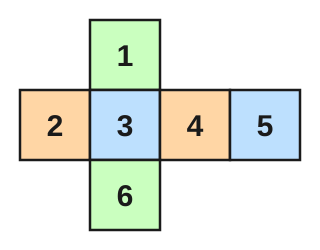
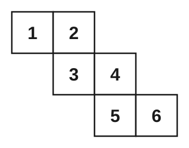
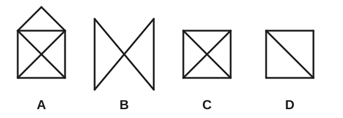
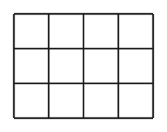

<!-- nav:top -->
[目次](../../README.md#目次) · 前へ: [数列](number-series.md) · 次へ: [言語（従来型）](verbal.md)
<!-- /nav:top -->

# 展開図・図形

**ひとことで言うと：** 立方体の展開図を頭の中で組み立てたり、図形の数を数えたり、一筆書きができるかを判断したりする問題です。

公式ページは、i9の数理に「空間把握を必要とする問題」が含まれると説明しています。就活サイトや対策本では、これを「展開図」「図形」と呼んで紹介するのが一般的です。センスの問題だと思われがちですが、実際には使えるルールがいくつかあり、それを知っているかどうかで差がつきます。

## 何を測る問題か

平面に描かれた図から、組み立てた後の形や、隠れている数を正確に読み取る力です。実際に紙を切って組み立てて確かめることはできないので、頭の中で確実に使えるルールを持っておくことが大切です。

## 問題の形

| タイプ | 内容 | 使うルール |
|---|---|---|
| 展開図 | 立方体の展開図を組み立てたとき、向かい合う面や隣り合う面を答える | 一直線に並んだ3面の両端は向かい合う |
| 一筆書き | 同じ線を2度通らずに描けるかを判断する | 奇数本の線が集まる点の数 |
| 図形の個数 | 図の中にある正方形や三角形の数を数える | 大きさごとに分けて数える |

## 解き方の手順

### 展開図：向かい合う面

1. **一直線に並んだ3つの面を探す。** 一直線に3つ並んでいれば、両端の2面は向かい合います。

   

   上の十字形では、横一列の2・3・4・5のうち、2と4、3と5が向かい合います。縦の1・3・6でも、1と6が向かい合います。
2. **一直線に3つ並んでいない面は、面を動かして考える。** L字の角で接している2つの面は、組み立てると辺どうしがぴったり重なります。そのため、片方の面を角を軸に90度回して、もう一方の面の隣へ移しても同じ立方体になります。移した後で一直線に3つ並べば、手順1が使えます。
3. **答えが出たら、残りの面で確かめる。** 向かい合う面は3組で、どの面も1回だけ使われます。重なりがあれば、どこかで間違えています。

### 一筆書き

1. **線が集まっている点ごとに、何本集まっているかを数える。** 線が交わっている点も1つの点として数えます。
2. **奇数本の点の数を数える。** 0個か2個なら一筆書きができ、4個以上ならできません。
3. **2個のときは、その片方から描き始める。** 描き始めと描き終わりが奇数本の点になります。

### 図形の個数

1. **いちばん小さい図形から順に、大きさごとに数える。** 1マス、2×2、3×3のように分けると、数え漏れと重複が防げます。
2. **格子なら計算で確かめる。** 縦mマス・横nマスの格子にあるk×kの正方形は、(m－k＋1)×(n－k＋1)個です。

## よくある落とし穴

- **展開図で「隣にあるから向かい合わない」と決めつける。** 展開図の上で離れていても隣り合う面はあり、逆に、離れて見える面が向かい合うこともあります。必ず手順1と2で確かめます。
- **一筆書きで交点を数え忘れる。** 対角線が交わる点も、線が集まる点です。
- **図形の個数で大きい図形を忘れる。** 1マスの数だけ数えて終わる人が多いです。全体を囲む図形も1つと数えます。

## 時間配分

展開図は手順に慣れれば1問1分以内で解けます。一筆書きは点の数を数えるだけなので30秒以内が目標です。図形の個数は、大きさごとの小計をメモしながら数えると、見直しも速くなります。

## 練習問題

次の3問は、このガイドのために作ったオリジナル問題です。TG-WEBやヒューマネージの資料、ほかの対策サイトから取ったものではありません。図はこのガイドのために描いたものです。

**問1.** 次の展開図を組み立てて立方体を作ります。1の面と向かい合う面はどれですか。

ア. 2　イ. 3　ウ. 4　エ. 5　オ. 6

**問2.** 次のA〜Dの図のうち、一筆書きで描けないものはどれですか。線が交わる点も、線が集まる点として数えます。

ア. A　イ. B　ウ. C　エ. D　オ. すべて描ける

**問3.** 次の図は、縦3マス、横4マスの格子です。この図の中に、大きさの違うものも含めて正方形はいくつありますか。

ア. 12　イ. 17　ウ. 18　エ. 20　オ. 24

解答と解説（問1〜3）

**問1：ウ（4）。** 1は2の左、3は2の下にあり、1と3は2の左下の角で接しています。組み立てると、1の下の辺と3の左の辺がぴったり重なるので、1の面は3の左隣へ動かせます。動かすと1・3・4が横一列に並び、両端の1と4が向かい合います。同じように、5を3の下へ動かすと2・3・5が縦に並んで2と5が、6を4の右へ動かすと3・4・6が並んで3と6が向かい合います。3組がすべて違う面でできているので、矛盾はありません。*ア・イではない理由：* 2と3は、組み立てると1の隣になる面です。

**問2：ウ（C）。** 線が集まる点の数を数えます。Cは四隅にそれぞれ3本（辺2本と対角線1本）、中央の交点に4本の線が集まっています。奇数本の点が4個あるので、一筆書きはできません。Aは屋根の両端の角に4本ずつ、下の2つの角に3本ずつ、屋根の頂点（2本）と中央の交点（4本）は偶数本です。奇数本の点は2個なので、下の角の片方から描き始めれば描けます。Bは奇数本の点が0個、Dは対角線の両端の2個で、どちらも描けます。*アではない理由：* Cに屋根を足すと上の2つの角が4本になり、奇数本の点が2個に減るので描けるようになります。

**問3：エ（20）。** 大きさごとに数えます。1×1の正方形は3×4＝12個、2×2は(3－1)×(4－1)＝6個、3×3は(3－2)×(4－2)＝2個です。合計12＋6＋2＝20個です。*アではない理由：* 1×1だけを数えた数です。*ウではない理由：* 3×3の2個を忘れています。

もっと解きたい人へ：PrepClubsの無料TG-WEB形式模擬テストは全21問（言語12問・計数9問）、30分で、従来型と同じ形式を時間を計って解けます。[TG-WEB形式の無料模擬テスト（PrepClubs）](https://prepclubs.com/ja/tg-web-taisaku?utm_source=github&utm_medium=referral&utm_campaign=7n35ny&utm_content=tg-web)

## 自己採点

| 問 | 1 | 2 | 3 |
|---|---|---|---|
| 正解 | ウ | ウ | エ |

- **3問正解：** 空間把握のルールは使えています。ほかの形の展開図でも同じ手順が使えるか試してください。
- **2問正解：** 間違えたのが展開図なら手順2（面を回して一直線に並べる）、一筆書きなら交点の数え方を見直してください。
- **1問以下：** まず十字形の展開図で、向かい合う面の3組をすぐ言えるようにしましょう。そこから面を1つずつ動かす練習に進むと、ほかの形にも対応できます。

## 次のステップ

展開図や図形は、時間に追われると見直しを省きがちな問題です。[PrepClubsの無料TG-WEB形式模擬テスト](https://prepclubs.com/ja/tg-web-taisaku?utm_source=github&utm_medium=referral&utm_campaign=7n35ny&utm_content=tg-web)で、ほかのタイプと混ざった状態でも手順どおりに解けるか確かめてください。

---

<!-- nav:bottom -->
← 前へ: [数列](number-series.md) | 次へ: [言語（従来型）](verbal.md) → | [目次に戻る](../../README.md#目次)
<!-- /nav:bottom -->
